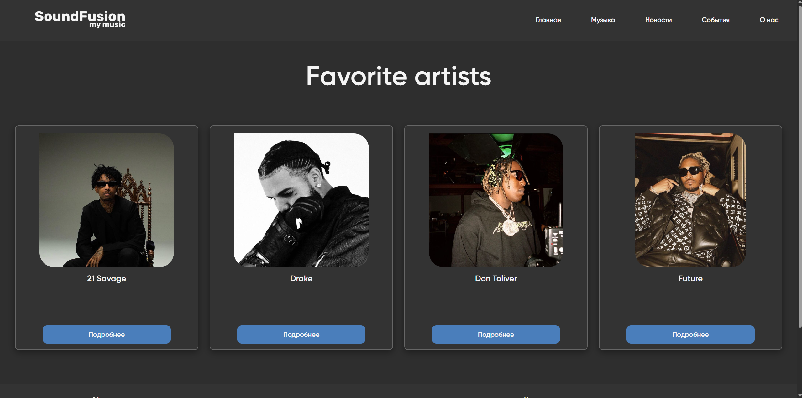
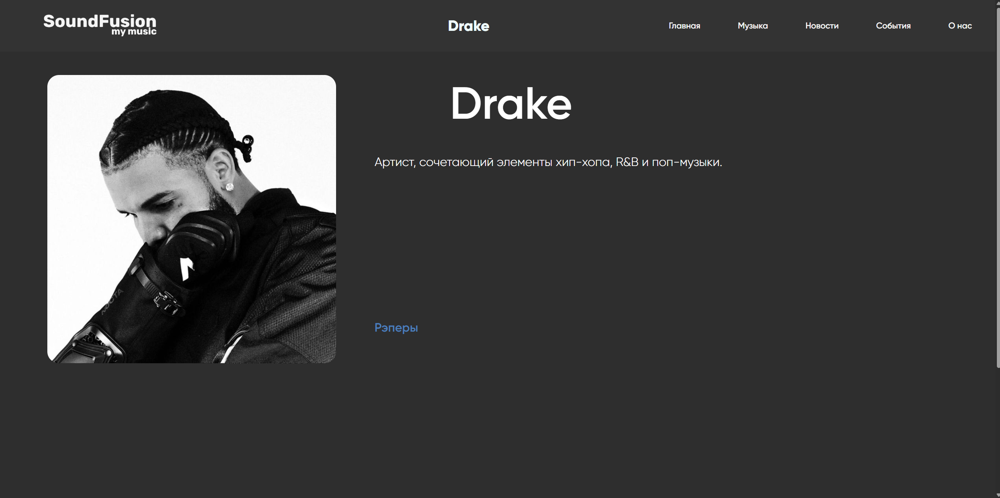

# SoundFusion — First Version

The first version of SoundFusion, a music website featuring a music content catalog and artist pages.

## Features

- Music content catalog
- Artist pages
- Dynamic content powered by PHP and MySQL

## Technologies

- PHP
- MySQL
- HTML
- CSS

## Database Structure

- `main` — main navigation.
- `menu` — menu links.
- `industry` — content categories.
- `content` — music content cards.

## Screenshots

### Home Page

### Artists

## Local Setup

1. Install [Laragon](https://laragon.org/).
2. Start Apache and MySQL.
3. Create a database named `db_web`.
4. Import `database/db_web.sql`.
5. Check the database connection settings in `function.php`.
6. Open `http://localhost/SoundFusion-firsttry/` in your browser.

---

# SoundFusion — Первая версия

Первая версия музыкального веб-сайта SoundFusion с каталогом музыкального контента и страницами исполнителей.

## Возможности

- Каталог музыкального контента
- Страницы исполнителей
- Динамическое отображение данных с помощью PHP и MySQL

## Технологии

- PHP
- MySQL
- HTML
- CSS

## Структура базы данных

- `main` — основная навигация.
- `menu` — ссылки меню.
- `industry` — категории контента.
- `content` — карточки музыкального контента.

## Скриншоты

### Главная страница

### Исполнители

## Локальный запуск

1. Установите [Laragon](https://laragon.org/).
2. Запустите Apache и MySQL.
3. Создайте базу данных `db_web`.
4. Импортируйте файл `database/db_web.sql`.
5. Проверьте настройки подключения к базе данных в `function.php`.
6. Откройте `http://localhost/SoundFusion-firsttry/` в браузере.
